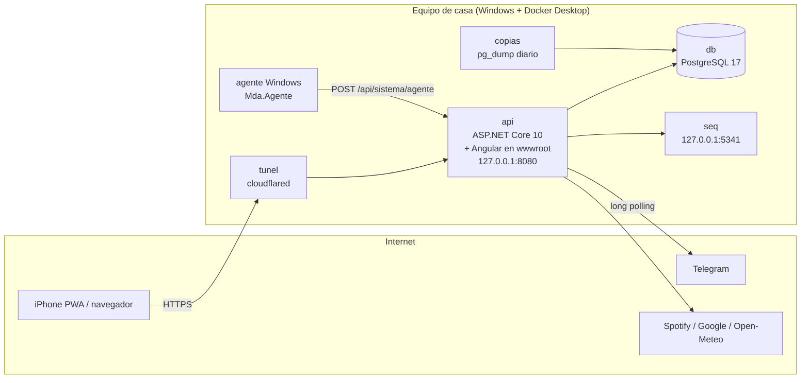

# Zona privada · MDA

App personal de Mario («zona privada»): un panel que corre en el **equipo de casa** (Windows + Docker Desktop)
y se usa desde el móvil (PWA en el iPhone) y el PC a través de Internet con HTTPS, sin abrir puertos del router.

Junta en un solo sitio: el estado del PC en directo, la **cartera** (gastos, ingresos, saldo, huchas, presupuestos,
recurrentes, gasolina, deudas del coche), la **agenda** (eventos, recordatorios, horario de trabajo, Google Calendar),
**notas**, **documentos** del PC, **música** (Spotify), **el tiempo**, un **asistente** que entiende frases en español
(«ayer 12 € en el Mercadona», «dentista el martes de 10 a 11:30») y un **bot de Telegram** que hace lo mismo desde el chat.

> 📚 Documentación detallada en [`docs/`](docs/) — empieza por [docs/README.md](docs/README.md).
> Si eres un asistente de IA ayudando con este repo, lee también [CLAUDE.md](CLAUDE.md).

---

## 🚀 Cómo levantarlo todo

### Requisitos

| Herramienta | Versión | Para qué |
|---|---|---|
| Docker Desktop | reciente (con WSL 2 en Windows) | producción: PostgreSQL, API, Seq, copias, Cloudflare Tunnel |
| .NET SDK | 10.0 | desarrollo de la API, tests, agente de Windows |
| Node.js | 24+ (npm 11) | desarrollo del front (Angular 22) |
| Git | cualquiera | — |

### A) Producción en el equipo de casa (lo que está en marcha)

```bash
# 1. Configuración (una vez): copia la plantilla y rellena los valores
cp .env.example .env          # en Windows: copy .env.example .env
#    obligatorios: POSTGRES_PASSWORD, ADMIN_USUARIO, ADMIN_EMAIL, ADMIN_PASSWORD (12+, mejor una frase larga), SEQ_PASSWORD, CLOUDFLARE_TUNNEL_TOKEN
#    opcionales:   URL_PUBLICA, ALLOWED_HOSTS, AGENTE_TOKEN, CARPETA_*, CORREO_*, WHATSAPP_*, TELEGRAM_TOKEN, SPOTIFY_*, GOOGLE_*

# 2. Todo (base de datos, API con el front dentro, Seq, copias diarias) + Cloudflare Tunnel (HTTPS público)
docker compose up -d --build

# 3. Comprobar
docker compose ps
curl http://localhost:8080/api/salud          # {"estado":"ok",...}
```

- App en local: **http://localhost:8080** · en Internet: **https://app.wolvem.dev** (Cloudflare Tunnel).
- Registros (Seq): **http://localhost:5341** (usuario `admin`, contraseña `SEQ_PASSWORD`).
- El usuario administrador se crea (o se actualiza su contraseña) al arrancar la API con `ADMIN_*` del `.env`.
- Las **migraciones** de la base de datos se aplican solas al arrancar.
- Para que el panel muestre el **PC real** (no la VM de Docker), arranca el agente de Windows: doble clic en
  `agente/arrancar.cmd` (necesita `AGENTE_TOKEN` en `.env`). Ver [docs/06-despliegue-y-operacion.md](docs/06-despliegue-y-operacion.md).

**Actualizar tras cambiar código** (lo habitual):

```bash
docker compose up -d --build api              # recompila front + API y reinicia solo la API
```

El túnel de Cloudflare ("zona-privada") sale con todo lo demás; su ruta `app.wolvem.dev` → `http://api:8080` se configura en
Cloudflare (Zero Trust → Networks → Tunnels) y `CLOUDFLARE_TUNNEL_TOKEN` es obligatorio en `.env`.

### B) Desarrollo rápido sin Docker (base de datos en memoria)

Dos terminales. Los datos se pierden al parar la API.

```bash
# Terminal 1 — API en http://localhost:5195 con base de datos en memoria y un usuario de prueba
cd api
ASPNETCORE_ENVIRONMENT=Development Datos__EnMemoria=true \
Admin__Usuario=wolve Admin__Email=prueba@local.test Admin__Password=clave-de-prueba \
dotnet run --project Mda.Api --urls http://localhost:5195
```

```powershell
# (lo mismo en PowerShell)
cd api
$env:ASPNETCORE_ENVIRONMENT='Development'; $env:Datos__EnMemoria='true'
$env:Admin__Usuario='wolve'; $env:Admin__Email='prueba@local.test'; $env:Admin__Password='clave-de-prueba'
dotnet run --project Mda.Api --urls http://localhost:5195
```

```bash
# Terminal 2 — front con recarga en caliente en http://localhost:4200 (proxy de /api y /hubs a :5195)
cd web
npm install
npm start
```

Entra en http://localhost:4200 con `wolve` / `clave-de-prueba`.

### C) Desarrollo contra PostgreSQL real

```bash
docker compose up -d db seq
# expón el puerto de la base solo en local: crea compose.override.yaml con
#   services: { db: { ports: ["127.0.0.1:5432:5432"] } }
cd api
dotnet user-secrets --project Mda.Api set "ConnectionStrings:Postgres" "Host=localhost;Port=5432;Database=zonaprivada;Username=mda;Password=<POSTGRES_PASSWORD>"
dotnet user-secrets --project Mda.Api set "Admin:Usuario" "<usuario>"
dotnet user-secrets --project Mda.Api set "Admin:Email" "<email>"
dotnet user-secrets --project Mda.Api set "Admin:Password" "<contraseña>"
dotnet run --project Mda.Api --urls http://localhost:5195
# y el front como en B)
```

### Tests

```bash
dotnet test ZonaPrivada.slnx          # API: xUnit + WebApplicationFactory con base en memoria (~130 tests)
cd web && npx ng test --watch=false   # front: Vitest + jsdom
cd web && npx ng build                # comprobar que el front compila
```

---

## 🧱 Tecnologías

| Capa | Tecnología | Detalles |
|---|---|---|
| Front | **Angular 22** | componentes *standalone*, **signals**, *zoneless*, control flow `@if/@for`, rutas *lazy* por pantalla |
| Gráficas | **ECharts 6** | medidores de CPU, historial, estadísticas de gastos |
| 3D | **Three.js 0.187** | candado 3D de la pantalla de entrar |
| Tiempo real | **SignalR** (`@microsoft/signalr`) | `/hubs/sistema` emite métricas cada 2 s |
| Otros front | `qrcode` (QR del 2FA), View Transitions API, Web Push, Service Worker propio (`public/sw.js`) |
| API | **ASP.NET Core 10** (C#, *Minimal APIs*) | módulos `MapXxx()` por carpeta, `BackgroundService` para tareas periódicas |
| Datos | **PostgreSQL 17** + **EF Core 10** (Npgsql) | migraciones en `api/Mda.Api/Data/Migraciones`, se aplican al arrancar; InMemory para dev/tests |
| Usuarios | **ASP.NET Core Identity** (`MapIdentityApi`) | cookie `HttpOnly` + `SameSite=Strict`, 2FA TOTP, bloqueo tras 5 fallos, sin registro público, sesiones revocables |
| Registros | **Serilog** + **Seq** | consola + Seq en `http://seq:5341` |
| Notificaciones | **Web Push** (VAPID propio, paquete `WebPush`), correo SMTP, WhatsApp (CallMeBot), **Telegram Bot API** |
| Integraciones | Spotify (OAuth), Google Calendar (OAuth), **Open-Meteo** (tiempo, sin clave) |
| Despliegue | **Docker Compose** (imagen única multi-etapa), **Cloudflare Tunnel**, copias `pg_dump` diarias |
| Tests | **xUnit** + `Microsoft.AspNetCore.Mvc.Testing` · **Vitest** + jsdom |
| Agente | consola .NET 10 en Windows que manda CPU/RAM/discos/red reales a la API |

---

## 🗺️ Arquitectura en una imagen



- **Una sola imagen** (`Dockerfile`): compila Angular, lo copia a `wwwroot` y publica la API. La API sirve el front
  y cualquier ruta que no sea `/api/*` ni `/hubs/*` devuelve `index.html`.
- **Ningún puerto abierto al exterior**: la API escucha en `127.0.0.1:8080`; Internet entra por el túnel de Cloudflare (conexión saliente).
- Detalle completo: [docs/01-arquitectura.md](docs/01-arquitectura.md).

---

## 📦 Módulos (qué hace la app)

| Módulo | Front | API | Resumen |
|---|---|---|---|
| Inicio | `web/src/app/inicio` | `Sistema/`, varios | saludo, mosaico (dinero del mes, tiempo, música, coche, agenda, recordatorios, notas, seguridad, gasolina, carpetas), KPIs del PC en directo |
| Cartera | `web/src/app/gastos` | `Gastos/` | movimientos con categorías y foto del ticket, recurrentes, saldo real, huchas, presupuestos con avisos, consejos 50/30/20, gasolina y consumo, deudas (coche) y mantenimiento |
| Agenda | `web/src/app/agenda` | `Agenda/` | mes en rejilla, día por horas con **horario de trabajo** de fondo, eventos/recordatorios con repetición y avisos (correo, WhatsApp, push, Telegram), Google Calendar |
| Notas | `web/src/app/notas` | `Notas/` | Markdown, tareas `- [ ]`, colores, etiquetas, fijadas/archivadas |
| Documentos | `web/src/app/documentos` | `Archivos/` | carpetas del PC montadas en Docker: ver, subir, descargar, mover, renombrar, papelera |
| Fotografía | `web/src/app/fotografia` | `Luz/` | «Cuándo salir a hacer fotografía»: el cielo hora a hora (sol, luna, nubes por capas, sombra, estrellas y Vía Láctea animados con datos reales), línea del día con la nota de cada hora, mejores momentos, semana y avisos |
| Música | `web/src/app/musica` | `Conexiones/` | Spotify: lo que suena, control, recientes, cola, top |
| Seguridad | `web/src/app/seguridad` | `Seguridad/`, `Auth/` | sesiones abiertas, accesos, 2FA con QR, llaves de acceso (Face ID) con nombre y datos del dispositivo, bloqueo al volver a la app, señuelos, tokens de Atajos, botón de pánico, canales de aviso |
| Mi PC | `web/src/app/pc` | `Pc/` | render 3D del PC, salud (discos, tendencia a 90 días), batería, volumen y brillo, órdenes firmadas (bloquear, reiniciar, apagar… con Face ID), «llegué a casa / me voy» y modo concentración, música del PC, aparatos de la red de casa, portapapeles compartido y avisos del PC (descargas, Windows, copias, batería) |
| Perfil | `web/src/app/perfil` | `Seguridad/Perfil.cs` | nombre, contacto, foto, cambiar contraseña |
| Asistente | `web/src/app/shell/asistente.ts` | `Asistente/` | intérprete de frases en español por reglas (sin IA externa): gastos, ingresos, huchas, eventos, horario, preguntas |
| Telegram | Seguridad › Avisos | `Telegram/` | bot vinculado a un solo chat: avisos + asistente desde el chat (/hoy, /tiempo, /saldo) |
| El tiempo | `web/src/app/inicio/tiempo.ts` | `Tiempo/` | Open-Meteo, previsión por horas y semana, aviso la víspera de lluvia/tormenta/calor/helada |

Detalle por módulo: [docs/02-backend.md](docs/02-backend.md) y [docs/04-frontend.md](docs/04-frontend.md).
Todas las rutas HTTP: [docs/03-api.md](docs/03-api.md).

---

## 📁 Estructura del repositorio

```
.
├── api/
│   ├── Mda.Api/                 API ASP.NET Core 10
│   │   ├── Program.cs           arranque: servicios, middleware, MapXxx() de cada módulo
│   │   ├── Agenda/              eventos, horario de trabajo, recordatorios, Google Calendar
│   │   ├── Archivos/            Documentos (carpetas del PC) + papelera
│   │   ├── Asistente/           Interprete.cs (reglas en español) + endpoint /entender
│   │   ├── Auth/                Identity (login/2FA), semilla del administrador
│   │   ├── Avisos/              correo, WhatsApp, Web Push, plantilla HTML del correo, Vigilante (tareas periódicas)
│   │   ├── Conexiones/          OAuth Spotify / Google, música
│   │   ├── Data/                AppDbContext, Adjunto, Migraciones/
│   │   ├── Gastos/              movimientos, recurrentes, cartera, huchas, presupuestos, deudas, coche
│   │   ├── Notas/               notas
│   │   ├── Seguridad/           cabeceras, sesiones, accesos, ajustes, perfil
│   │   ├── Sistema/             lectura de CPU/RAM/discos/red, hub SignalR
│   │   ├── Telegram/            bot (long polling), conversación, vinculación
│   │   └── Tiempo/              Open-Meteo
│   └── Mda.Api.Tests/           xUnit (API completa en memoria)
├── agente/Mda.Agente/           agente de Windows (métricas reales del PC)
├── web/                         Angular 22
│   ├── public/                  sw.js, manifest, iconos, fuentes, img/avatar.webp
│   └── src/app/                 core/, shell/, entrar/, inicio/, gastos/, agenda/, notas/, documentos/, musica/, perfil/, seguridad/, pronto/
├── compose.yaml                 db, api, seq, copias, tunel (Cloudflare)
├── Dockerfile                   imagen única: front + API
├── .env.example                 plantilla de configuración (el .env real NUNCA se sube)
├── CLAUDE.md                    guía rápida para asistentes de IA
└── docs/                        documentación detallada
```

---

## ⚙️ Configuración (`.env`)

Todas las variables y a qué se mapean dentro de la API: [docs/06-despliegue-y-operacion.md#variables-de-entorno](docs/06-despliegue-y-operacion.md#variables-de-entorno).
Resumen:

| Variable | Obligatoria | Uso |
|---|---|---|
| `POSTGRES_PASSWORD` | sí | contraseña de PostgreSQL |
| `ADMIN_USUARIO`, `ADMIN_EMAIL`, `ADMIN_PASSWORD` | sí | la única cuenta; se sincroniza al arrancar |
| `SEQ_PASSWORD` | sí | panel de registros |
| `URL_PUBLICA` | recomendable | enlaces de los correos y vueltas OAuth |
| `ZONA_HORARIA` | no (`Europe/Madrid`) | repeticiones y avisos en hora local |
| `AGENTE_TOKEN` | para el agente | token compartido API ↔ agente |
| `CARPETA_*` | no | carpetas del PC que se ven en Documentos |
| `CORREO_*` | no | avisos por correo (SMTP) |
| `WHATSAPP_*` | no | avisos por WhatsApp (CallMeBot) |
| `TELEGRAM_TOKEN` | no | bot de Telegram (@BotFather) |
| `SPOTIFY_*`, `GOOGLE_*` | no | cuentas enlazadas por OAuth |
| `CLOUDFLARE_TUNNEL_TOKEN` | sí | token del túnel de Cloudflare (la ruta pública `app.wolvem.dev`) |

---

## 🔐 Seguridad en breve

Cookie `HttpOnly`/`SameSite=Strict`/`Secure`, 2FA TOTP, bloqueo 15 min tras 5 fallos, 10 intentos de login por minuto e IP,
sesiones revocables desde otro equipo, CSP estricta sin scripts de terceros, registro de accesos, tokens OAuth cifrados con
Data Protection, rutas de Documentos confinadas a sus raíces (sin enlaces simbólicos), secretos solo en `.env`.
Detalle: [docs/07-seguridad.md](docs/07-seguridad.md).

---

## 📚 Índice de la documentación

1. [Arquitectura](docs/01-arquitectura.md) — piezas, flujo de una petición, autenticación, tareas de fondo, modelo de datos
2. [Backend](docs/02-backend.md) — cada módulo de la API por dentro (incluido el intérprete del asistente)
3. [API HTTP](docs/03-api.md) — todas las rutas con método, cuerpo y respuesta
4. [Frontend](docs/04-frontend.md) — estructura Angular, rutas, servicios, estilos, temas, PWA
5. [Integraciones](docs/05-integraciones.md) — Telegram, Spotify, Google Calendar, correo, WhatsApp, Web Push, Open-Meteo
6. [Despliegue y operación](docs/06-despliegue-y-operacion.md) — Docker, Cloudflare Tunnel, variables, copias, restaurar, base de datos, agente, problemas típicos
7. [Seguridad](docs/07-seguridad.md)
8. [Desarrollo](docs/08-desarrollo.md) — convenciones, tests, migraciones, cómo añadir un módulo, trucos
