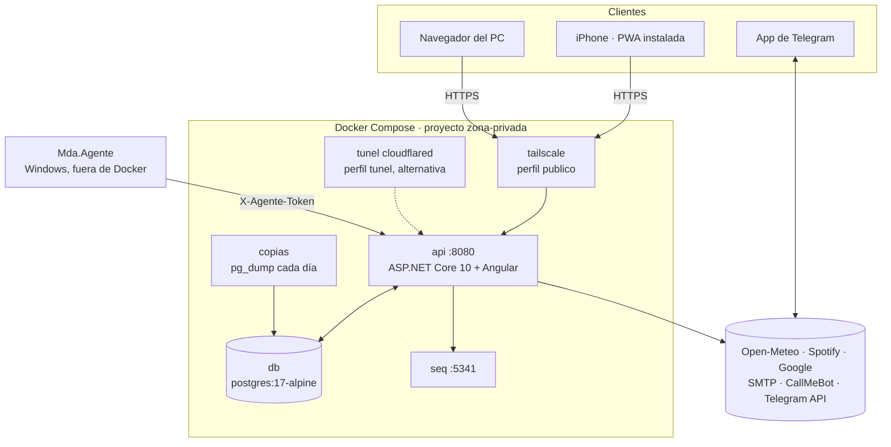
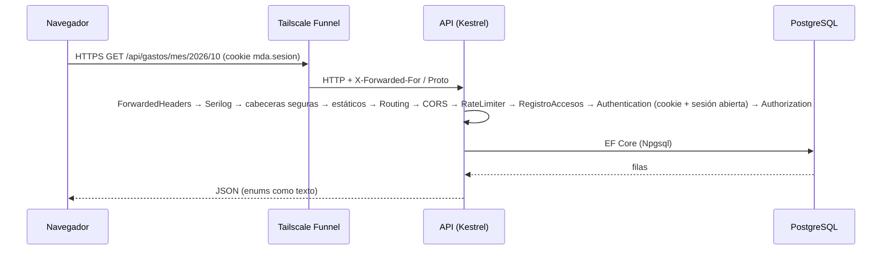

# 1. Arquitectura

## Visión general

La zona privada es una **aplicación de un solo usuario** (el dueño) que vive en el PC de casa. No hay nube propia:
todo (base de datos, API, front, registros, copias) corre en contenedores de Docker Desktop sobre Windows, y se
publica en Internet con **Tailscale Funnel**, que da una dirección HTTPS fija sin abrir puertos del router.



### Contenedores (`compose.yaml`)

| Servicio | Imagen | Puerto | Función |
|---|---|---|---|
| `db` | `postgres:17-alpine` | interno | datos (volumen `db`); *healthcheck* `pg_isready` |
| `api` | construida con `Dockerfile` | `127.0.0.1:8080` | API + front; `hostname: equipo-de-casa` (sale en el panel) |
| `seq` | `datalust/seq:2026.1` | `127.0.0.1:5341` | registros estructurados (volumen `seq`) |
| `copias` | `postgres:17-alpine` | — | bucle: cada 10 min, si son más de las 3:00 y hoy no hay copia, `pg_dump -Fc` a `./copias`; guarda 14 |
| `tailscale` | `tailscale/tailscale` | 443 público | perfil `publico`; Funnel → `http://api:8080` (`tailscale/serve.json`) |
| `tunel` | `cloudflare/cloudflared` | — | perfil `tunel`; alternativa a Tailscale |

Volúmenes: `db`, `seq`, `claves` (claves de Data Protection: la sesión sobrevive a reinicios), `tailscale` (estado del nodo).
Montajes: `./copias` (solo lectura en la API, para vigilar que existan), carpetas del PC en `/carpetas/<id>` para Documentos.

### Imagen (`Dockerfile`, multi-etapa)

1. `node:24-alpine`: `npm ci` + `ng build --configuration production`.
2. `dotnet/sdk:10.0`: `dotnet restore` + copia `dist/web/browser` a `wwwroot` + `dotnet publish`.
3. `dotnet/aspnet:10.0`: solo el publicado, usuario sin privilegios (`$APP_UID`), puerto 8080, carpeta `/claves`.

## Flujo de una petición



Orden del *pipeline* en `Program.cs` (importa):

```
UseForwardedHeaders → UseSerilogRequestLogging → UseCabecerasSeguras → UseDefaultFiles → UseStaticFiles
→ UseRouting → UseCors → UseRateLimiter → UseRegistroAccesos → UseAuthentication → UseAuthorization
→ Map*() de cada módulo → MapFallbackToFile("{*ruta:regex(^(?!api/|hubs/).*$)}", "index.html")
```

- Los estáticos van **antes** del enrutado: si no, la ruta comodín del front se quedaría con los `.js`/`.css`.
- Toda ruta que no empiece por `api/` ni `hubs/` devuelve `index.html` (enrutado de Angular).
- JSON con `JsonStringEnumConverter`: los enums viajan como texto (`"Gasto"`, `"Mensual"`).

## Autenticación y sesiones

- **ASP.NET Core Identity** con `AddIdentityApiEndpoints<IdentityUser>` y `MapIdentityApi` bajo `/api/auth`.
  Se cierran `/register`, `/forgotPassword`, `/resetPassword` y `/resendConfirmationEmail` (devuelven 404).
- **Solo cookie** (`mda.sesion`): `HttpOnly`, `SameSite=Strict`, `Secure` en producción, 8 h deslizantes.
  El front hace `POST /api/auth/login?useCookies=true`.
- El campo del login se llama `email` pero **Identity busca por nombre de usuario** (`Admin:Usuario`).
- Una API no redirige: sin sesión responde **401**, sin permiso **403**.
- **2FA TOTP** (app autenticadora): se activa desde Seguridad con un QR (`/api/auth/manage/2fa`). Al entrar,
  el login responde que falta el código y el front lo pide (`twoFactorCode`).
- **Bloqueo**: 5 fallos → 15 minutos (`LockoutEnd` en `AspNetUsers`). **Límite por IP**: 10 intentos/min en `/api/auth/*`.
- **Sesiones revocables** (`Seguridad/Sesiones.cs`): al entrar se crea una fila en `sesiones` y su id va como *claim*
  en la cookie. En cada petición se comprueba que siga abierta → se pueden ver y cerrar sesiones de otros equipos.
  La pestaña abierta manda un «latido» cada minuto (para el «en línea»).
- **Registro de accesos** (`accesos`): cada `POST /api/auth/login` con IP, agente y resultado (los 300 últimos).
- **Semilla del administrador** (`Auth/SemillaAdmin.cs`): al arrancar aplica migraciones y crea/actualiza el usuario
  con `Admin:Usuario/Email/Password`. Si la contraseña de la configuración no coincide con la guardada, la restablece.

## Tiempo real

- `MonitorSistema` (`BackgroundService`) lee el equipo cada 2 s y emite `"metricas"` por SignalR en `/hubs/sistema`
  (solo con sesión). Guarda ~2 min en memoria para pintar la gráfica nada más entrar (`GET /api/sistema`).
- Dentro de Docker solo se ve la VM de WSL; por eso existe el **agente de Windows** (`agente/Mda.Agente`), que lee el PC
  real (`GetSystemTimes`, `GlobalMemoryStatusEx`, discos, interfaces de red) y lo manda a `POST /api/sistema/agente`
  con la cabecera `X-Agente-Token`. Si deja de llegar, el monitor vuelve a medir el contenedor (y el front lo indica).

## Tareas de fondo (`IHostedService`)

| Servicio | Frecuencia | Qué hace |
|---|---|---|
| `SemillaAdmin` | al arrancar (primero) | migraciones + usuario administrador |
| `MonitorSistema` | 2 s | métricas → SignalR |
| `Recordatorios` | 30 s | avisos de eventos/recordatorios que tocan → correo / WhatsApp / push / Telegram. WhatsApp sale 5 min antes y el resto a la hora; cada canal se anota aparte y se reintenta solo el que falla (1, 5 y 15 min). Si no llega por ninguno, o el equipo estuvo apagado más de 12 h, te lo cuenta por Telegram |
| `Vigilante` | 15 min (de día) | lunes desde las 9: resumen semanal; mantenimiento del coche (máx. 1 aviso/semana); copia de seguridad con más de 30 h (1 aviso/día); desde las 20:00, aviso del tiempo de mañana |
| `Sondeo` (Telegram) | continuo | `getUpdates` con long polling (50 s) y despacha cada mensaje a `Conversacion` |

## Modelo de datos (PostgreSQL)

Tablas de Identity (`AspNetUsers`, `AspNetUserTokens`… con mayúsculas) y tablas propias en minúsculas:

```mermaid
erDiagram
  movimientos }o--o| recurrentes : "RecurrenteId (SetNull)"
  movimientos }o--o| deudas : "DeudaId (SetNull)"
  movimientos ||--o| adjuntos : "ticket:{Id}"
  movimientos { int Id; string Tipo; date Fecha; decimal Importe; string Categoria; string Concepto; string Notas; decimal Litros; decimal PrecioLitro; int Kilometros; bool TieneTicket }
  recurrentes { int Id; string Nombre; string Tipo; string Categoria; decimal Importe; bool Variable; int Dia; string Frecuencia; date Inicio; date Fin; bool Activo }
  deudas { int Id; string Nombre; decimal Total; string Categoria; date Inicio }
  huchas { int Id; string Nombre; decimal Objetivo; decimal Ahorrado; string Color; string Emoji; date Fecha }
  presupuestos { string Categoria PK; decimal Limite; string AvisadoMes; int AvisadoNivel }
  mantenimientos { int Id; string Nombre; int CadaKm; int CadaMeses; date UltimaFecha; int UltimoKm }
  eventos { int Id; string Tipo; string Titulo; string Lugar; timestamptz Inicio; timestamptz Fin; bool TodoElDia; string Color; string Repetir; int AvisoMinutos; bool PorCorreo; bool PorWhatsApp; bool PorPush; bool PorTelegram; timestamptz ProximoAviso; bool Hecho; string GoogleId }
  notas { int Id; string Titulo; string Contenido; string Color; string Etiquetas; bool Fijada; bool Archivada }
  conexiones { string Proveedor PK; string RefreshToken; string AccessToken; timestamptz Caduca; string Cuenta }
  sesiones { string Id PK; string UsuarioId; timestamptz UltimaVez; string Ip; string Agente; bool App; timestamptz Cerrada }
  accesos { int Id; timestamptz Fecha; string Ip; bool Exito; string Motivo }
  ajustes { string Clave PK; string Valor }
  adjuntos { string Clave PK; string Tipo; bytes Datos }
  push { int Id; string Endpoint; string P256dh; string Auth; string Dispositivo }
```

Notas clave:

- `timestamptz` siempre en **UTC** (convención global en `AppDbContext.ConfigureConventions`). Las fechas sin hora son `date` (`DateOnly`).
- `adjuntos` guarda binarios pequeños aparte para que listar no cargue bytes: `ticket:{id}` (foto del ticket), `avatar` (foto de perfil).
- `ajustes` es un almacén clave → valor (JSON a menudo). Claves en uso:

| Clave | Contenido |
|---|---|
| `horario` | horario de trabajo `{"activo","nombre","dias":[1..7],"entrada":"08:30","salida":"17:30"}` |
| `telegram-chat`, `telegram-nombre` | chat vinculado al bot |
| `tiempo-lugar`, `tiempo-avisos`, `tiempo-avisado` | ciudad del tiempo, si avisar la víspera, último aviso |
| `resumen-semanal`, `resumen-ultimo` | resumen del lunes activado y última vez |
| `copias-avisado` | último aviso de copia antigua |
| `saldo-base` | base del saldo (saldo = base + ingresos − gastos) |
| `vapid-publica`, `vapid-privada` | claves de Web Push (se generan solas la primera vez) |
| `perfil-nombre`, `perfil-apellidos`, … | datos del perfil |
| `avisar-inicios` | avisar de cada inicio de sesión |

- Migraciones en `api/Mda.Api/Data/Migraciones` (EF Core); se aplican solas al arrancar.
